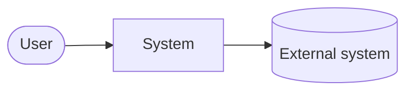

# Target architecture

<header>

<Structure follows arc42, trimmed to what is useful.>

## 1. Goals and constraints
<Top drivers, key NFRs, and constraints — link to 02-requirements.md.>

## 2. Context (C4 level 1)


## 3. Solution strategy
<Chosen style(s) and why, key technology choices, with ADR links.>

## 4. Containers (C4 level 2)
```mermaid
flowchart LR
  %% applications, services, data stores, brokers
```
| Container | Responsibility | Technology | Hosting target | Owner |
|---|---|---|---|---|

## 5. Technology stack
| Component | Language | Runtime and version | Framework | Key libraries | Tests | Change vs legacy |
|---|---|---|---|---|---|---|

<Link to the technology stack ADR.>

## 6. Front end
<"No user interface" if none. Otherwise: users, technology, hosting, authentication, real-time data flow, BFF or gateway.>

## 7. Components (C4 level 3, only where useful)

## 8. Runtime scenarios
<Key flows as Mermaid sequence diagrams: happy path, a failure path, startup/recovery.>

## 9. Data
| Store | Data domain | Source of truth? | Consistency | Retention | Backup/restore |
|---|---|---|---|---|---|

## 10. Integration contracts
| Interface | Style (sync/async) | Protocol | Delivery guarantee | Versioning | Owner |
|---|---|---|---|---|---|

## 11. Configuration and service discovery
| Kind of configuration | Owner | Home | Reload | Audit |
|---|---|---|---|---|

<How components find each other; link to the infrastructure document for details.>

## 12. Cross-cutting concepts
<Error handling, idempotency, caching, resilience patterns (timeouts, retries, circuit breakers), time and clock handling.>

## 13. Quality scenarios
| NFR | Scenario | How the design meets it |
|---|---|---|

## 14. Risks and technical debt
## 15. Glossary
