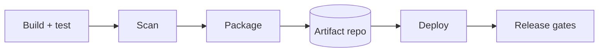

# Infrastructure and deployment

<header>

## Environments
| Environment | Purpose | Data | Sizing vs prod | Access |
|---|---|---|---|---|

## Deployment topology
```mermaid
flowchart TB
  %% components grouped by hosting target (OpenShift namespace, Windows hosts, …)
```
| Component | Hosting target | Instances / scaling | Packaging |
|---|---|---|---|

## Pipeline

| Stage | Tool | Output | Gate / approval |
|---|---|---|---|

### Release orchestration
<Templates, phases, gates, change windows, cross-team dependencies.>

## Configuration
| Key / group | Kind | Owner | Source per target | Differs per env? | Hot reload? | Audit? |
|---|---|---|---|---|---|---|

## Service discovery
| Component | Finds | Mechanism | Health check | Failover behaviour |
|---|---|---|---|---|

## Secrets delivery
<Per target; link to the security document.>

## Rollout and rollback
| Component | Strategy | Progress gate (health check) | Rollback trigger | Rollback steps | Data implications |
|---|---|---|---|---|---|

## Operational settings
### OpenShift workloads
<Requests/limits, probes, autoscaling, security context, affinity.>
### Windows services
<Service account, recovery options, install folders, startup/shutdown timeouts, log locations.>
### Other targets

## Infrastructure as code
| Scope | Tool | Repository | Applied by | Manual parts |
|---|---|---|---|---|

## Capacity and resilience
<Sizing assumptions, redundancy, DR approach vs RTO/RPO.>
